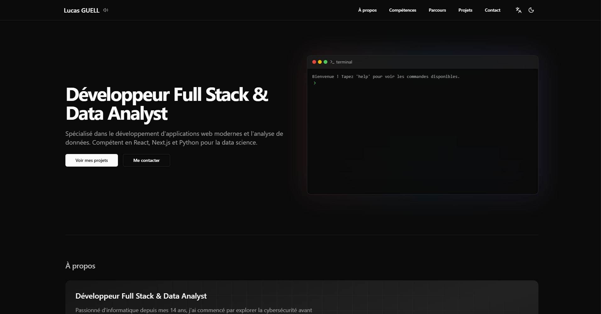

# LePortfolio2025

Portfolio web personnel, statique et responsive, développé avec React, TypeScript, Tailwind CSS et Vite.

[](https://react.dev/)
[](https://www.typescriptlang.org/)
[](https://vite.dev/)
[](https://tailwindcss.com/)
[](https://motion.dev/)
[](https://ui.shadcn.com/)
[](https://eslint.org/)
[](LICENSE)

Site en ligne : [lucasguell.com](https://lucasguell.com)



## Fonctionnalités

- **Terminal interactif** : console intégrée à la page d'accueil. La commande `help` liste les commandes disponibles : présentation, compétences, projets, contact. La commande `games` donne accès à deux mini-jeux, `guess` (deviner un nombre) et `calc` (calcul mental).
- **Projets filtrables** : chaque projet affiche les logos de ses technologies, et la liste peut être filtrée par technologie.
- **Trois langues (anglais, français, espagnol)** : la langue suit celle du navigateur (anglais par défaut), et un sélecteur permet d'en changer ; le choix du visiteur est mémorisé.
- **Thème clair, sombre ou système** : le thème suit la préférence de l'appareil, et le choix du visiteur est mémorisé.
- **Prononciation du nom** : lecture audio intégrée à l'en-tête.
- **Clé PGP publique** : copiable en un clic depuis la section Contact.
- **Animations** : apparitions au défilement avec Motion, désactivées lorsque le système demande de réduire les animations.
- **Responsive** : mise en page adaptée du mobile (menu latéral) au grand écran.
- **Contenu séparé du code** : l'ensemble des textes est stocké dans un fichier JSON par langue (voir [Modification du contenu](#modification-du-contenu)).

## Sections

| Section | Contenu |
|---|---|
| Accueil | Présentation et terminal interactif |
| À propos | Parcours et spécialisations |
| Compétences | Technologies et outils, classés par catégorie |
| Parcours | Formations |
| Projets | Réalisations, filtres par technologie, liens vers le code source et les démonstrations |
| Contact | Email, GitHub, LinkedIn et clé PGP |

## Stack technique

| Domaine | Outils |
|---|---|
| Interface | [React 19](https://react.dev/), [TypeScript 6](https://www.typescriptlang.org/) |
| Style | [Tailwind CSS 4](https://tailwindcss.com/), [shadcn/ui](https://ui.shadcn.com/) (basé sur [Radix UI](https://www.radix-ui.com/)) |
| Animations | [Motion](https://motion.dev/) |
| Icônes | [Lucide](https://lucide.dev/), [Radix Icons](https://www.radix-ui.com/icons), [Devicon](https://devicon.dev/) |
| Compilation | [Vite 8](https://vite.dev/) |
| Qualité du code | [ESLint 10](https://eslint.org/), [typescript-eslint](https://typescript-eslint.io/), règles React Hooks |

## Installation

Prérequis : [Node.js](https://nodejs.org/) 20.19 ou plus récent (ou 22.12+).

```bash
git clone https://github.com/Luckickio/LePortfolio2025.git
cd LePortfolio2025
npm install
npm run dev
```

Le serveur de développement est accessible sur http://localhost:5173.

### Scripts

| Commande | Rôle |
|---|---|
| `npm run dev` | Serveur de développement avec rechargement à chaud |
| `npm run build` | Vérification des types (TypeScript), puis compilation dans `dist/` |
| `npm run preview` | Service local du dossier `dist/` pour tester la version compilée |
| `npm run lint` | Analyse du code avec ESLint |

Remarque : ouvrir `dist/index.html` directement depuis le disque affiche une page blanche, car les navigateurs bloquent les scripts chargés depuis un fichier local. La version compilée doit être servie par `npm run preview` ou par un hébergeur.

## Structure du projet

```
├── index.html               # Page HTML de base (titre, balises SEO, favicon)
├── public/
│   └── assets/              # Images copiées telles quelles dans le build
│       ├── Educations/      #   logos des établissements
│       └── projects/        #   captures d'écran des projets
└── src/
    ├── main.tsx             # Point d'entrée
    ├── App.tsx              # Assemblage des sections
    ├── index.css            # Thème Tailwind (couleurs, modes clair et sombre)
    ├── components/          # Sections du site (Hero, About, Projects, etc.)
    │   └── ui/              # Composants shadcn/ui
    ├── data/locales/        # Textes du site, un fichier par langue
    │   ├── en.json
    │   ├── fr.json
    │   └── es.json
    ├── i18n/                # Détection et changement de langue
    ├── hooks/useSEO.ts      # Mise à jour des balises meta
    └── assets/              # Logos et fichier audio importés dans le code
```

## Modification du contenu

Les textes ne sont pas écrits dans les composants : ils sont centralisés dans un fichier par langue, dans [`src/data/locales/`](src/data/locales/) (`en.json`, `fr.json`, `es.json`). Chaque fichier contient le référencement (titre, description), la navigation, l'accueil, les réponses du terminal, la section À propos, les formations, les compétences, les projets, le contact et les libellés de l'interface (`ui`).

Les trois fichiers ont la même structure : une modification de contenu (ajout d'un projet, d'une formation…) doit être reportée dans chacun d'eux.

Emplacement des images :

- **Image référencée dans les fichiers de langue** (capture de projet, logo d'établissement) : à placer dans `public/assets/`. Le chemin s'écrit sans `public`, par exemple `"/assets/projects/Projet.png"`.
- **Image importée dans un composant** (logo de technologie) : à placer dans `src/assets/` et à importer avec `import logo from "@/assets/..."`.

## Déploiement

Le site est hébergé sur GitHub Pages, avec un domaine personnalisé.

1. Compiler le site avec `npm run build`.
2. Copier le contenu de `dist/` à la racine du dépôt GitHub Pages, en conservant le fichier `CNAME`.

## Contact

- Email : [contact@lucasguell.com](mailto:contact@lucasguell.com)
- GitHub : [github.com/Luckickio](https://github.com/Luckickio)
- LinkedIn : [linkedin.com/in/lucasguell](https://linkedin.com/in/lucasguell)

## Licence

Tous droits réservés. Le code source est publié à des fins de consultation uniquement : aucune licence n'est accordée, et toute reproduction, modification, redistribution ou réutilisation, totale ou partielle, est interdite sans autorisation écrite préalable. Voir [LICENSE](LICENSE).

Les marques, logos et composants open source de tiers restent la propriété de leurs titulaires respectifs. Ils sont listés dans [THIRD_PARTY_NOTICES.md](THIRD_PARTY_NOTICES.md).

© 2025 Lucas GUELL
